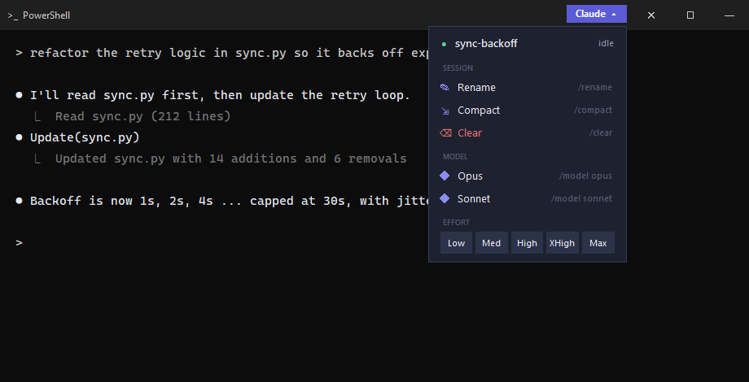
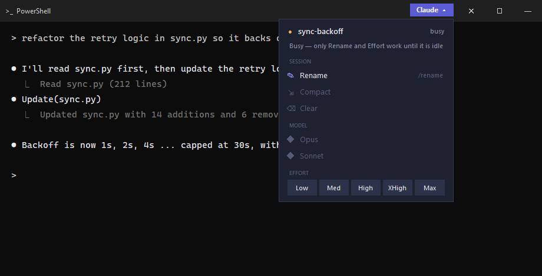
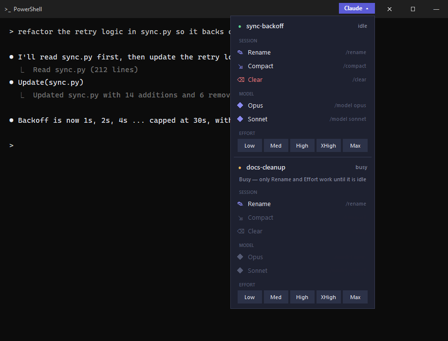

# ClaudeTab

A small **Claude ▾** tab that sits on the top-right corner of any Windows terminal
window running a live [Claude Code](https://claude.com/claude-code) session. Click it to
rename, compact or clear the session, or switch between Opus and Sonnet — without typing
a slash command.



- **Zero dependencies** — Python 3 standard library only (`tkinter` + `ctypes`).
- **Doesn't steal focus** — the handle and menu never take focus from your terminal.
- **Safe by construction** — only a fixed allowlist of commands is ever sent, and only while the session is idle.
- **Works with Windows Terminal tabs and classic console windows**, and lists every session when one window hosts several.

## Menu

| Group   | Action  | Sends                                  |
|---------|---------|----------------------------------------|
| Session | Rename  | `/rename` (Claude picks the name)      |
| Session | Compact | `/compact`                             |
| Session | Clear   | `/clear`                               |
| Model   | Opus    | `/model opus` + confirms the prompt    |
| Model   | Sonnet  | `/model sonnet` + confirms the prompt  |
| Effort  | Low / Med / High / XHigh / Max | `/effort <level>` + confirms a cache warning if shown |

While a session is busy only **Rename** and **Effort** work; the rest are greyed out:



If one window hosts several sessions (and the window title doesn't pick one), each gets its own block:



## Install

Requirements: Windows 10/11, Python 3.8+ with tkinter (included in the python.org installer).

```powershell
git clone <this repo>
cd claude-tab
pythonw claude_tab.pyw            # run now, in the background
.\install_startup.ps1        # optional: also start at logon
```

- `install_startup.ps1` puts `ClaudeTab.lnk` in your Startup folder and (re)starts ClaudeTab. Delete the shortcut to undo.
- Stop it by ending `pythonw.exe` in Task Manager.
- Only one copy runs at a time; a second launch exits immediately.

## How it works

- **Sessions** come from `~/.claude/sessions/<pid>.json`, written by Claude Code itself
  (`CLAUDE_CONFIG_DIR` is honoured).
- **Which window** — each session's console is matched to the terminal that hosts it via
  `AttachConsole` + `GetConsoleWindow`. Process ancestry can't answer this: with Windows
  Terminal as the default terminal, `claude`'s parents lead to `explorer`. With several tabs
  in one Windows Terminal window, the tab whose name appears in the window title wins.
- **Acting** — the command and Enter are written straight into the session's console input
  buffer with `WriteConsoleInputW`, so nothing is "typed" into whichever window has focus.
- **Model switches** ask "are you sure?"; Enter is pressed at 350 / 700 / 1100 ms
  (`CONFIRM_DELAYS_MS`). An Enter that lands before or after the prompt hits an empty input box and does nothing.

## Settings

Constants at the top of `claude_tab.pyw`: `MODELS`, `EFFORTS`, `SIMPLE`, `CONFIRMED`, `CONFIRM_DELAYS_MS`,
`OFFSET_RIGHT` / `OFFSET_TOP` (handle position) and the colour constants (`BG`, `HOVER`, `ACCENT`, …).

## Limits

- A half-typed draft in the prompt box gets the command appended to it.
- Windows only; the console-injection approach has no macOS/Linux equivalent here.
- Errors go to `%TEMP%\claude_tab.log`.

## Regenerating the screenshots

`python tools/make_screenshots.py` (needs Pillow). It renders the real menu code on a mock
terminal with made-up sessions, so no real session data appears in the images.

## License

[MIT](LICENSE)
